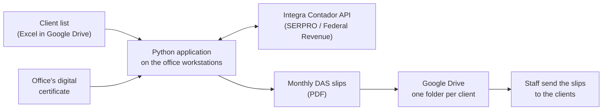

# Accounting Office Automation (Brazil)

A Python application that automates a monthly compliance task for Brazilian accounting offices: issuing and filing the monthly tax payment slips of their micro-entrepreneur clients through the official government API.

**In production since 09/2026, now in 3 accounting offices on 11 workstations.**

> **About this repository:** this is a case study. The source code is private. This page explains the problem, how the solution is built and what it achieved.

---

## At a glance

| | |
|---|---|
| **My role** | Sole developer: requirements with a pilot office, development, rollout, remote support for all offices |
| **Stack** | Python · Integra Contador REST API (SERPRO, Brazilian Federal Revenue) · digital certificate authentication · Excel · Google Drive |
| **Users** | Office staff without a technical background |
| **Status** | In production: 3 offices, 11 workstations (3 + 4 + 4) |

---

## The problem

In Brazil, every micro-entrepreneur registered as **MEI** pays a monthly tax through a payment slip called **DAS**. Accounting offices usually handle this for dozens of clients each month: log in to the government portal, generate each slip, download the PDF, file it and send it to the client.

It is the same manual routine every month, client by client. It takes hours, and a forgotten or late slip means late payment for the client.

---

## The solution

**Monthly cycle:** on the 10th of each month the office runs the application for the previous period, well before the payment deadline.

1. The application reads the active clients from the shared Excel list.
2. For each client it requests the slip from the official government API, authenticated with the office's digital certificate.
3. The PDF is saved in that client's Google Drive folder.
4. Staff send the slips to the clients.

### Design decisions

- **Official API instead of screen scraping.** The government API is stable and authenticated, so nothing breaks when a web page changes.
- **Uses tools the offices already have.** Excel and Google Drive, with no server and no new subscription, which keeps running costs close to zero for small offices.
- **Clear access separation.** Only the office owner sees the main folder. Staff see the client list and the generated PDFs.
- **Messaging API evaluated and dropped.** The WhatsApp Business (Meta) API was tested, but setup effort and cost didn't fit small offices. Sending stays with the staff on a dedicated number, so the office's main number is never at risk.
- **Gradual rollout.** First one real client, then small client groups, then the whole client list.
- **Build for one office, design for many.** Every improvement is developed with the pilot office and then rolled out to all installations.
- **Real data stays in the offices.** My development machine holds no client data.

---

## Results

- Monthly slips for the whole client list **issued and filed automatically** instead of client by client
- **In production since 09/2026**, now in **3 accounting offices on 11 workstations**
- Operated day to day by office staff, with **remote support** from me

---

## Roadmap

- [ ] More message templates, each with its own schedule, plus monthly payment reminders for clients
- [ ] Platform for receiving client documents
- [ ] Easier distribution: Windows installer or hosted web version
- [ ] User manual and onboarding material for new staff
- [ ] AI-assisted workflow (Claude) to prepare and check income tax returns. Currently in testing.

---

## About the code

The source code is private. More details are available on request.

**Author:** [Henrique Gomes Pais](https://github.com/Henrique-Gomes-Pais) · [LinkedIn](https://www.linkedin.com/in/henrique-gomes-pais-633060312/)
